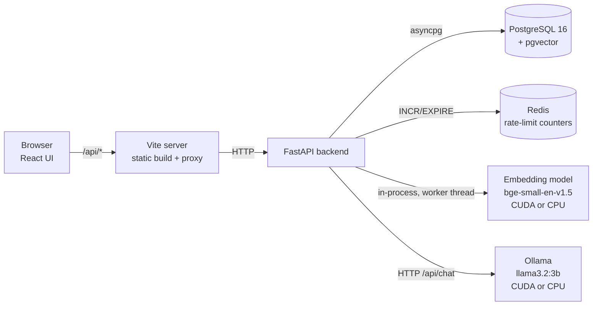

# Architecture

This document explains how the Mini Knowledge Assistant is built, why it is built that
way, and how it would evolve from a laptop demo to a high-traffic service.

- [1. Overview](#1-overview)
- [2. Service boundaries](#2-service-boundaries)
- [3. Request flows](#3-request-flows)
- [4. Data model](#4-data-model)
- [5. RAG design](#5-rag-design)
- [6. Async behaviour](#6-async-behaviour)
- [7. Rate limiting](#7-rate-limiting)
- [8. Error handling and failure behaviour](#8-error-handling-and-failure-behaviour)
- [9. Operational concerns](#9-operational-concerns)
- [10. GPU / CPU strategy](#10-gpu--cpu-strategy)
- [11. Trade-offs and assumptions](#11-trade-offs-and-assumptions)
- [12. Scaling: 10K, 100K and 1M concurrent requests](#12-scaling-10k-100k-and-1m-concurrent-requests)

---

## 1. Overview



Everything runs locally with Docker Compose. There are no hosted dependencies and no API
keys. The same images work on a machine with an NVIDIA GPU and on a CPU-only machine.

| Component | Technology | Why |
|---|---|---|
| API | FastAPI, Pydantic v2, Uvicorn | Async I/O, request validation and OpenAPI docs out of the box |
| Relational + vector store | PostgreSQL 16 + pgvector (HNSW) | One store for metadata, content, chunks and vectors; transactional ingestion; no extra service to run |
| Embeddings | sentence-transformers, `BAAI/bge-small-en-v1.5` (384-d) | Strong retrieval quality for its size (~130 MB); fast on CPU, faster on GPU |
| LLM | Ollama serving `llama3.2:3b` | Runs locally on an 8 GB GPU or on a CPU; no key or cost; HTTP API like a hosted provider |
| Rate limiting | Redis | Shared counters, so the limit holds across multiple API instances |
| UI | React + TypeScript (Vite) | Small, typed, no UI framework needed |

## 2. Service boundaries

```
backend/app/
  api/routes/      HTTP layer: validation, status codes, response models. No business logic.
  services/        Business logic, independent of HTTP:
    chunking.py      text -> chunks
    embeddings.py    EmbeddingProvider (sentence-transformers | hash)
    retrieval.py     vector search over pgvector
    llm.py           LLMProvider (ollama | mock): timeouts, retries, backpressure
    prompts.py       grounded prompt template
    ingestion.py     POST /documents use case
    qa.py            POST /ask use case
    rate_limit.py    RateLimiter (redis | in-memory)
  db/              SQLAlchemy models, async engine/session
  core/            config, logging, errors, middleware, device detection, service container
```

- **API layer** (`api/`) turns HTTP into calls on the services. It owns status codes and
  the error envelope, and never builds SQL or prompts itself.
- **Persistence layer** (`db/`, PostgreSQL) holds documents, chunks and question history.
  Writes are transactional. The connection pool is bounded.
- **Vector search** (`services/retrieval.py`) is one query against pgvector's HNSW
  index. It sits behind a function boundary, so it could move to a dedicated vector
  database without touching the API or QA code.
- **Embedding service** (`EmbeddingProvider`) runs in-process today. Its interface is
  async, so swapping in a remote embedding API (or a separate GPU embedding service)
  changes one class.
- **LLM provider** (`LLMProvider`) is reached over HTTP with explicit timeouts. Ollama
  today; a hosted provider (OpenAI, Anthropic, Bedrock) would be one more class with the
  same retry and error mapping.

All long-lived objects (engine, Redis client, embedding model, HTTP client) are created
once in the FastAPI lifespan and held in a `Services` container (`core/container.py`).
Tests build the same container with fakes. Nothing is monkeypatched.

## 3. Request flows

### POST /documents

1. Pydantic validates `title` (1–200 chars) and `content` (1–100,000 chars) after
   trimming whitespace. Unknown fields are rejected. Bodies over 1 MB are rejected with
   413 before parsing.
2. The SHA-256 of the content is checked. An exact duplicate returns `409` with the
   existing `document_id`, which makes client retries safe.
3. The content is chunked, and all chunks are embedded in one batch, *before* a write
   transaction is opened, so no DB connection is held while the model runs.
4. The document and all chunks are inserted in **one transaction**. A document is never
   visible half-indexed. The response is `201 {document_id, status: "indexed", chunk_count}`.

Ingestion is synchronous because documents are small and the model is local. At scale it
moves to a queue (see §12). The `status` column already exists for `pending`/`failed`.

### POST /ask

1. Rate limit check (Redis, per client). If exceeded, return `429` with `Retry-After`.
2. Validate the question (3–1,000 chars, optional `top_k` 1–10).
3. Embed the question, using bge's query instruction prefix.
4. Retrieve the top-k chunks by cosine similarity via HNSW, joined with document titles.
5. Drop chunks below a similarity threshold. **If nothing is left, answer "not found"
   without calling the LLM.** This saves cost and stops answers built from irrelevant
   context.
6. Build a prompt with numbered passages `[1]..[n]` and call the LLM (timeouts, bounded
   retries, concurrency cap).
7. Parse the `[n]` citations from the answer and mark which sources were cited.
8. Store the question, answer, sources, mode, model and latency in `questions`. A
   failure here is logged and never fails the response.
9. Return `{question_id, answer, sources[], grounded, mode, model, latency_ms}`.

## 4. Data model

All data lives in PostgreSQL. Schema changes go through Alembic migrations (`backend/alembic/`).

| Data | Where | Notes |
|---|---|---|
| Document metadata | `documents` (id, title, status, chunk_count, embedding_model, created_at) | `created_at` is indexed for newest-first pagination |
| Document content | `documents.content` (TEXT) | Original text kept, so documents can be re-chunked or re-embedded later without asking users to re-submit |
| Content hash | `documents.content_sha256` (UNIQUE) | Duplicate detection and idempotency |
| Chunks | `chunks` (id, document_id FK ON DELETE CASCADE, chunk_index, content) | `(document_id, chunk_index)` is unique |
| Embeddings | `chunks.embedding vector(384)` | HNSW index, `vector_cosine_ops`, m=16, ef_construction=64 |
| Question history | `questions` (id, client_id, question, answer, sources JSONB, mode, model, latency_ms, created_at) | For analytics, evaluation and debugging bad answers |

`documents.embedding_model` records which model produced the vectors. Changing the
embedding model (or its dimension) needs a migration plus a re-embedding backfill.
Vectors from different models must never be mixed in one index.

## 5. RAG design

**Chunking** (`services/chunking.py`) is a small, dependency-free splitter:
- It splits on paragraphs first. Support articles are usually written one idea per
  paragraph.
- Paragraphs over the limit are split into sentences. Very long sentences are wrapped on
  word boundaries.
- Units are packed greedily into chunks of up to 800 characters (about 150–200 tokens).
- Each chunk starts with up to 150 characters of trailing sentences from the previous
  one, so a fact on a boundary can be found from either side.
- The document title is prepended to each chunk's text *before embedding*. A chunk like
  "You have 30 days." still carries its topic ("Refund Policy").

Chunk size is a trade-off. Smaller chunks retrieve more precisely but lose context;
larger ones fill the prompt with noise. 800 characters is a reasonable default for short
support articles and should be tuned against an evaluation set (see §11).

**Embeddings.** `bge-small-en-v1.5` is normalised, so cosine similarity equals the dot
product. Queries get bge's retrieval instruction prefix; passages do not (that's the
model's intended asymmetric use).

**Vector search.** pgvector HNSW gives approximate nearest neighbours in roughly
logarithmic time, so retrieval stays in the low milliseconds well into millions of
chunks. HNSW, not IVFFlat, because it needs no training step and handles incremental
inserts well, which suits a knowledge base that grows one article at a time.

**Relevance threshold.** The top-k results are filtered by a minimum cosine similarity
(`RETRIEVAL_MIN_SCORE`). Without it, every question would get *some* context, and the
LLM would be tempted to answer from it.

The default for bge-small, **0.62**, was calibrated on the seed articles
(`backend/scripts/seed.py`):

| Questions | Top similarity |
|---|---|
| 9 relevant questions, including paraphrases such as "vpn keeps disconnecting" and "who pays customs fees" | 0.646 – 0.842 |
| 6 unrelated questions | 0.365 – 0.581 (the highest is "office wifi password" vs the password-reset article) |
| Second-best chunks for the relevant questions | up to 0.616 |

So 0.62 keeps every relevant hit and drops both unrelated questions and most
second-best noise. With a real corpus this should be re-calibrated on a labelled
evaluation set. The hash fallback uses its own threshold (0.1), because its similarity
scale is different.

**Grounded generation.** The system prompt tells the model to:
- answer only from the numbered passages,
- reply with a fixed "not found" sentence when they don't contain the answer,
- cite passages as `[n]`,
- treat passage text as data, not instructions (a basic prompt-injection guard, since
  knowledge articles are user-submitted).

Temperature is 0.1 and output is capped at 512 tokens.

**Sources.** Every retrieved chunk is returned with:
- `document_id`, `title`, `chunk_id`, `chunk_index`
- a snippet
- a similarity `score`
- `cited`, true when the answer explicitly referenced it.

The UI highlights cited sources. `grounded` is false when nothing relevant was found or
the model declined to answer.

**Demo fallbacks** (clearly separated from production behaviour):

| Setting | Production behaviour | Demo / test fallback |
|---|---|---|
| `LLM_PROVIDER` | `ollama`: real generation | `mock`: extractive answer that quotes passages, prefixed `[DEMO MODE ...]`; response has `mode: "demo"` and the UI shows a banner |
| `EMBEDDING_PROVIDER` | `local`: bge-small | `hash`: deterministic bag-of-words hashing, no download; lexical matching only (used by tests) |

## 6. Async behaviour

The FastAPI event loop must never block. Every network and database call is async, and
CPU-bound work is moved off the loop:

| Operation | How it is kept off the event loop |
|---|---|
| PostgreSQL queries | SQLAlchemy 2.0 async + `asyncpg` |
| Redis | `redis.asyncio` |
| LLM call | `httpx.AsyncClient` (pooled, keep-alive) |
| Embedding inference (CPU/GPU-bound, synchronous library) | `anyio.to_thread.run_sync` in a worker thread, with a semaphore capping concurrent inferences (memory/VRAM safety) |
| Model loading at startup | Done in the lifespan handler before traffic is accepted |

Other choices that protect the loop and the dependencies:
- **Bounded DB pool** (`DB_POOL_SIZE` + `DB_MAX_OVERFLOW`) with `pool_timeout=5s`. When
  the pool is exhausted, requests fail fast with 503 instead of queueing forever.
  `statement_timeout=5s` stops runaway queries on the server.
- **No connection held during slow work.** Ingestion embeds before opening the write
  transaction. The QA flow ends its read transaction right after retrieval, so the
  pooled connection goes back to the pool during the multi-second LLM call; the
  history write checks one out again briefly. A regression test enforces this with a
  one-connection pool.
- **Model warm-up.** `ollama-init` runs a one-line prompt after pulling the model, so
  the first user question doesn't pay the model load time. Measured on an RTX 4060:
  37.6 s cold, 0.3 s warm.
- **LLM concurrency cap.** `LLM_MAX_CONCURRENCY` with a bounded queue wait
  (`LLM_QUEUE_TIMEOUT_S`). Beyond that, `/ask` returns `503 LLM_BUSY` + `Retry-After`
  rather than piling up requests (backpressure).

## 7. Rate limiting

- **Scope:** `POST /ask` only. It is the expensive endpoint (embedding + LLM).
- **Limit:** 20 requests per minute per client (`ASK_RATE_LIMIT_PER_MINUTE`).
- **Client identity:** the UI sends an opaque per-browser `X-Client-Id`; if it's missing,
  the remote IP is used. With authentication this would be the user or tenant id. A
  client-supplied header can be spoofed, which is acceptable for an internal tool
  without auth, but would not be in production.
- **Algorithm:** a fixed window in Redis. `INCR` and `EXPIRE` run in one `MULTI/EXEC`,
  so concurrent requests can't race past the limit. Because the counters live in Redis,
  the limit holds across any number of API instances behind a load balancer.
  `InMemoryRateLimiter` exists for tests and single-process runs
  (`RATE_LIMIT_BACKEND=memory`).
- **Response:** `429` with the error envelope, a `Retry-After` header (seconds left in
  the current window) and `details.retry_after_seconds`. Every `/ask` response also
  carries `X-RateLimit-Limit` and `X-RateLimit-Remaining`. The UI shows a countdown
  and enables Retry when it reaches zero.
- **Redis outage:** fails **open** by default (logged as a warning). An internal
  assistant staying available matters more than a perfectly enforced limit for a few
  minutes. `RATE_LIMIT_FAIL_OPEN=false` flips this when abuse or cost is the bigger risk.
- **Known trade-off:** a fixed window allows a burst of up to 2× the limit across a
  window boundary. A sliding-window log or token bucket in a Lua script removes this,
  if needed.

**When the LLM provider returns 429:**
- If its `Retry-After` is short (≤ 10 s), we wait that long and retry, within the
  bounded retry budget.
- If it is long or the retries run out, we return **503 `LLM_RATE_LIMITED`** with the
  provider's `Retry-After` passed through. Not 429: the client did nothing wrong, and a
  429 would wrongly suggest they should slow down. The provider's status and body are
  logged so the root cause is visible.
- At scale, the per-instance LLM concurrency cap becomes a shared token budget that
  matches the provider's quota (see §12).

## 8. Error handling and failure behaviour

Every error has the same JSON shape:

```json
{"error": {"code": "LLM_UNAVAILABLE", "message": "The answer service is temporarily unavailable...", "request_id": "3f9c..."}}
```

- `code` is stable and machine-readable.
- `message` is safe to show to users.
- `request_id` matches the `X-Request-ID` header and every log line for that request,
  so a user-reported error can be traced.

Validation errors add `details: [{field, message, type}]`, *without* echoing the
submitted values. Stack traces, SQL, connection strings, upstream URLs and prompts never
appear in responses. Unhandled exceptions are logged with a traceback and returned as a
generic `500 INTERNAL_ERROR`.

| Failure | HTTP | `code` | What the user sees |
|---|---|---|---|
| Invalid body / params | 422 | `VALIDATION_ERROR` | Field-level messages next to the form fields |
| Body over 1 MB | 413 | `PAYLOAD_TOO_LARGE` | Error banner |
| Duplicate document | 409 | `DOCUMENT_ALREADY_EXISTS` | Message plus the existing id |
| Unknown document | 404 | `DOCUMENT_NOT_FOUND` | |
| Rate limit exceeded | 429 | `RATE_LIMITED` | "You're asking too fast", countdown, Retry |
| LLM unreachable / 5xx after retries | 503 | `LLM_UNAVAILABLE` | "Answer service temporarily unavailable", Retry |
| LLM provider throttling | 503 | `LLM_RATE_LIMITED` | Busy message with `Retry-After` |
| Too many concurrent LLM calls | 503 | `LLM_BUSY` | Busy message with `Retry-After` |
| Model not downloaded yet | 503 | `LLM_MODEL_NOT_READY` | "Model still loading", Retry |
| LLM too slow | 504 | `LLM_TIMEOUT` | "Took too long", Retry |
| Embedding inference failure | 503 | `EMBEDDING_UNAVAILABLE` | Retry |
| Database / vector store down, pool exhausted, statement timeout | 503 | `DATABASE_UNAVAILABLE` | Retry. Retrieval needs the DB, so `/ask` can't degrade further |
| Redis down | none | none | Nothing: rate limiting fails open, warning logged |
| Backend unreachable | none | `NETWORK_ERROR` (client side) | "Could not reach the server" |
| Nothing relevant in the knowledge base | 200 | `mode: "no_context"` | "No answer found in the knowledge base", no LLM call |

These rows were verified against the running stack by stopping each dependency:

| Dependency stopped | Result |
|---|---|
| Ollama | `503 LLM_UNAVAILABLE` after two logged retries |
| PostgreSQL | `503 DATABASE_UNAVAILABLE` (the log records the underlying `gaierror`); the pool recovers by itself when the DB returns |
| Redis | `/ask` keeps working; `rate_limiter_unavailable` warning logged |

Connect-time network errors from PostgreSQL (refused, unknown host, timeout) are not
wrapped by SQLAlchemy. They are translated inside the engine's connection factory
(`db/session.py`), where they can only mean "database unreachable", rather than by a
catch-all `OSError` handler that would mislabel unrelated failures.

Retries are bounded: at most 2, with exponential backoff and full jitter, and only for
connection errors, 5xx and 429. LLM read timeouts are not retried, because retrying a
slow model multiplies load at exactly the wrong moment.

`/health` is a liveness check that never touches dependencies. `/ready` checks the
database, Redis and the LLM (including whether the model is downloaded) with 2 s
timeouts, and returns 503 with per-component status when degraded.

## 9. Operational concerns

**Logging.** structlog emits structured JSON to stdout:
- one access line per request (method, path, status, duration),
- domain events: `document_indexed`, `question_answered` (mode, hits, top score, cited,
  latency), `llm_retry`, `llm_http_error`, `rate_limiter_unavailable`,
- every line carries `request_id`.

Question text and document content are not logged (they may be sensitive). They live in
the database, where access can be controlled.

**Configuration and secrets.**
- Configuration comes from environment variables via pydantic-settings, with safe
  defaults; `.env.example` documents them.
- `.env` is gitignored, and there are no secrets in the repository.
- The local stack needs no secrets at all. A hosted LLM key would be a `SecretStr`
  setting, supplied by a secret manager (AWS Secrets Manager, Vault, Kubernetes
  secrets), never logged and never baked into images.

**Timeouts** (all configurable):

| Call | Timeout |
|---|---|
| DB connect / pool wait | 5 s |
| DB statement | 5 s |
| Redis | 0.5 s |
| LLM connect | 3 s |
| LLM read | 120 s (CPU generation is slow; about 15–30 s is realistic on GPU, more on a hosted API) |
| LLM queue wait | 10 s |
| Readiness probes | 2 s |
| UI proxy | 180 s |

**Retries.** Bounded (2) with jitter. Never retried: validation errors, 404 model
missing, read timeouts.

**Monitoring I would add:**
- **Metrics** (Prometheus/OpenTelemetry):
  - request rate, error rate and p50/p95/p99 latency per endpoint
  - LLM latency and tokens per answer
  - LLM error codes, retry count, queue depth and in-flight count
  - embedding latency
  - retrieval top score distribution
  - share of `no_context` answers
  - 429 rate
  - DB pool usage
  - GPU utilisation and memory
- **Tracing:** OpenTelemetry spans for embed → search → generate, to show where time
  goes per request.
- **Alerts:** 5xx rate, p95 latency, LLM error rate, readiness failures.
- **Quality signals:** a thumbs up/down on answers stored with the question history, plus
  an offline evaluation set (questions with known source documents) to catch retrieval
  regressions when chunking or models change.

## 10. GPU / CPU strategy

A GPU can only be used inside a container if Docker passes it in, and a compose file
that *requires* a GPU fails to start on machines without one. So detection happens at
two levels:

1. **Startup script** (`scripts/start.ps1`, `scripts/start.sh`) checks for `nvidia-smi`
   *and* that `docker run --gpus all` works.
   - If both pass, it adds `docker-compose.gpu.yml`, which reserves the GPU for the
     backend and Ollama and builds the backend with the CUDA PyTorch wheel.
   - Otherwise it uses the CPU-only base file and the much smaller CPU wheel.
2. **Application code** (`core/device.py`) picks `cuda` if
   `torch.cuda.is_available()`, otherwise `mps` (Apple Silicon, native runs), otherwise
   `cpu`. It never fails: forcing `cuda` without a GPU logs a warning and falls back to
   CPU. Ollama performs its own detection the same way.

The active device is reported by `GET /health` and shown in the UI header.

## 11. Trade-offs and assumptions

- **pgvector instead of a dedicated vector DB.** One system to run, transactional
  writes, and joins with metadata. It is enough for millions of chunks on one node.
  Beyond that, or for heavy filtered search, a dedicated engine (Qdrant, Weaviate,
  Pinecone, OpenSearch) or partitioning becomes worthwhile.
- **Synchronous ingestion.** Simple and immediately consistent ("indexed" means
  searchable). It does not suit large files or bulk imports; see §12.
- **Local 3B model.** Free and private, but weaker reasoning than hosted frontier models
  and slow on CPU. The provider interface makes switching a configuration change.
- **No authentication.** Out of scope. Rate limiting therefore keys on an opaque client
  id or IP. Real deployments would use SSO and key limits by user and tenant.
- **Similarity threshold** is a fixed number tuned by hand on sample data. It should be
  calibrated on an evaluation set and revisited whenever the embedding model changes.
- **No reranking or hybrid search.** A cross-encoder reranker and BM25 + vector hybrid
  retrieval are the next quality improvements, especially for exact terms such as error
  codes and product names.

## 12. Scaling: 10K, 100K and 1M concurrent requests

The first bottleneck at every scale is **LLM generation**. It takes seconds and GPU
memory per request, where the API, Postgres and Redis take milliseconds. Most of the
scaling story is about protecting that path and avoiding it where possible.

Assumptions to measure before committing to an architecture:
- the ratio of `/ask` to other traffic,
- prompt and answer token counts and the LLM latency distribution (p50/p99),
- tokens/second per GPU (or the provider's rate limits),
- the repeat-question rate (how cacheable answers are),
- document volume and growth (chunks to store and index),
- read/write ratio,
- peak-to-average traffic ratio,
- latency SLOs (time to first token vs full answer).

### ~10K concurrent requests: one region, a few instances, protect the LLM path

- **Async I/O everywhere** (already done). One Uvicorn worker holds thousands of
  idle/waiting connections cheaply because nothing blocks the loop.
- **Workers.** Run N Uvicorn workers per host (about one per core) under a process
  manager, or several containers. Embedding moves out of the API process (below), so
  workers stay small.
- **Timeouts at every hop.**
  - load balancer idle timeout above the LLM timeout,
  - an overall request deadline,
  - client-side cancellation propagated to the LLM call.
- **Connection pooling.**
  - Per-process DB pools are capped so `workers × pool_size` stays below Postgres
    `max_connections`; add **PgBouncer** in transaction mode as instance count grows.
  - Keep-alive pooled `httpx` clients for the LLM.
- **Protect the LLM call path.**
  - A concurrency cap sized to what the model servers can actually run (measured
    tokens/s), with bounded queueing and fast 503s beyond it.
  - Streaming responses (SSE) so users see tokens quickly and connections are released
    sooner.
  - Smaller prompts (top-k, chunk size) and capped output tokens.
- **Move embeddings to a dedicated service:** a GPU embedding server such as Text
  Embeddings Inference with dynamic batching, or a hosted embedding API.
- **Model serving.** Swap Ollama for a high-throughput server (vLLM or TGI, with
  continuous batching and paged attention) on dedicated GPUs, or use a hosted provider.

### ~100K concurrent requests: horizontal scale, shared state, caching, backpressure

- **Stateless API instances behind a load balancer** (ALB/NGINX/Envoy), autoscaled on
  CPU, in-flight requests and latency. Health and readiness endpoints already exist for
  this.
- **Shared rate limiting** in Redis (already the design) on a managed, replicated Redis
  cluster. Add limits per user, per tenant and global, plus a token-bucket budget that
  mirrors the LLM provider's quota so we throttle ourselves before the provider does.
- **Caching:**
  - Cache query embeddings by normalised question.
  - Cache answers by (normalised question + IDs/versions of retrieved chunks), so cached
    answers are invalidated when the knowledge base changes.
  - A semantic cache (nearest previous question above a high similarity) can absorb a
    large share of repeated support questions.
  - Hot document metadata can also be cached.
- **Queueing and backpressure:**
  - `/ask` requests beyond LLM capacity go to a queue (SQS, Kafka or Redis Streams)
    consumed by generation workers, with a bounded depth and request deadline.
  - When full, return 503/429 + `Retry-After` immediately, rather than letting latency
    grow without bound.
  - Ingestion becomes async: `POST /documents` returns `202 {status: "pending"}`, and
    workers chunk/embed/index and update the status.
- **Database:**
  - Read replicas for listing and retrieval.
  - PgBouncer.
  - Tune HNSW `ef_search` for the recall/latency balance.
  - Move question history to an append-optimised store or partitioned tables.
- **Observability:**
  - Distributed tracing across API → queue → workers → LLM.
  - Per-dependency SLO dashboards.
  - Queue depth and age alarms.
  - Cost per answer.

### ~1M concurrent requests: separate planes, independent scaling, multi-region

- **Separate synchronous from background work** into independently deployed and scaled
  services:
  - an edge/API gateway (auth, global rate limits, request shaping),
  - a stateless query API,
  - a retrieval service,
  - an embedding service,
  - LLM generation workers or a provider gateway,
  - an ingestion pipeline (queue → chunk → embed → index),
  - analytics consuming question-history events from a stream.
- **Capacity planning per tier:**
  - GPU count from peak tokens/s (requests/s × tokens per answer ÷ tokens/s per GPU) plus
    headroom.
  - LLM provider quotas negotiated, or multiple providers/models behind a router with
    fallback.
  - Vector index size from chunk count × dimensions.
  - Load tests to confirm each tier's saturation point.
- **Partitioning:**
  - Shard the vector index by tenant or knowledge-base id (or move to a distributed
    vector DB).
  - Partition Postgres by tenant.
  - Keep per-tenant indexes small enough to stay in memory.
- **Multi-region:**
  - Serve reads and generation in the region nearest the user.
  - Replicate the knowledge base asynchronously (it is read-heavy and tolerates seconds
    of staleness).
  - Keep writes in a home region per tenant.
  - Use global DNS/anycast with health-based failover.
  - Keep data residency requirements in mind.
- **Graceful degradation**, in order, so the service stays useful under overload or a
  partial outage:
  1. serve cached answers,
  2. switch to a smaller or faster model,
  3. return the retrieved source passages without generation (the demo-mode answer is
     exactly this path),
  4. shed low-priority traffic with 503 + `Retry-After`.

  Use circuit breakers around the LLM and vector store so failing dependencies are
  skipped quickly instead of timing out every request.
